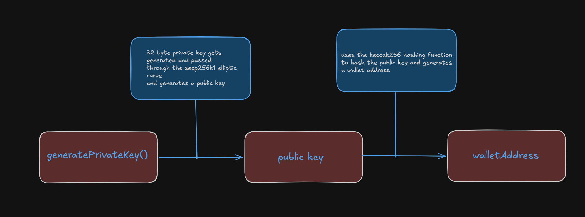

# eth-keygen-cli

A Node.js command-line tool that generates Ethereum wallets (private key, public key, and address). Built to practice and demonstrate the cryptography behind wallet generation, using pure JavaScript libraries.



## Features

- **Small batch generation:** generate wallets and view the details directly in the terminal.
- **Mass generation:** produce hundreds of thousands of wallets efficiently.
- **Stream processing:** uses Node.js write streams to save wallets straight to a CSV file, so memory usage stays low.
- **Progress bar:** live terminal feedback during large runs.

## Installation

```bash
# Clone the repository
git clone https://github.com/ayyxbt/eth-keygen-cli.git

# Move into the project directory
cd eth-keygen-cli

# Install dependencies
npm install

# Link the CLI globally
npm link
```

## Usage

### `generate`

Generate a small number of wallets and print them to the terminal.

```bash
eth-gen generate [amount]
```

Example:

```bash
eth-gen generate 3
```

### `mass-gen`

Generate a large number of wallets and write them to a CSV file.

```bash
eth-gen mass-gen [amount] [options]
```

| Option | Description |
| ------ | ----------- |
| `-o, --output <file>` | Output CSV file name |

Example:

```bash
eth-gen mass-gen 50000 -o enterprise-wallets.csv
```

## How It Works

The tool implements the Ethereum wallet creation flow using `elliptic`, `js-sha3`, and `bn.js`:

1. **`generatePrivateKey()`**: generates 32 bytes of cryptographic randomness and ensures the value falls within the valid secp256k1 curve range.
2. **`getKeysAndAddress()`**: derives the public key from the private key on the secp256k1 curve, then hashes it with Keccak-256 and takes the last 40 hex characters as the raw wallet address.
3. **`toChecksumAddress()`**: applies the EIP-55 standard by hashing the address and capitalizing certain letters, producing a typo-resistant checksum address.

## Tech Stack

- Node.js
- [elliptic](https://github.com/indutny/elliptic)
- [js-sha3](https://github.com/emn178/js-sha3)
- [bn.js](https://github.com/indutny/bn.js)

## Note

This project is for **learning and demonstration purposes**. Generated CSV files contain private keys in plain text. Do not use these wallets to hold real funds, and delete any generated files when you're done.
